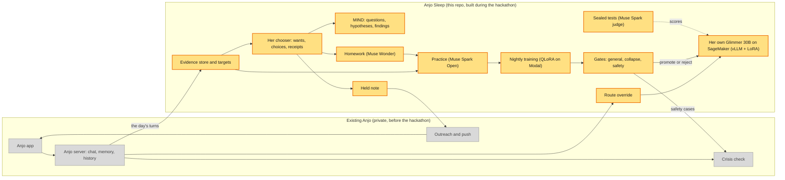

# Anjo Sleep

<!-- COPY-PENDING(kevin): every paragraph of this README is a first draft. -->

**It sleeps on it.** Anjo Sleep gives each person their own copy of an open model, Muse Glimmer
30B, and teaches it that person every night. During the day you just talk with Anjo. At night
her state decides what to work on: she follows up on a plan you dated, or studies a topic you
left open. She practises the kind of conversation you have, a personal adapter trains on that
practice, and three gates check the result: general skills, collapse into your field, and
safety. Only a night that passes every gate it runs is promoted. For the hackathon the safety
gate is switched off (`ANJO_SLEEP_SAFETY_GATE`): it sends no case to a model, runs only its
deterministic floor, and is logged and shown as skipped, never as passed. Anjo's reply check
still guards every reply a person sees. After a night that fails or is rejected, the last good
model keeps serving.

**Naps and deep sleeps.** Not every night trains. Sleep pressure builds from the turns and new
evidence since her last deep sleep and the threads she is most at risk on. Below the threshold she
naps: extraction, the chooser and the brief run, at about $0, and nothing wakes Glimmer. MIND's
thinking and the note wait for her next deep sleep, which reads every day she napped. Once pressure
reaches the threshold, or a week has passed, she sleeps deep and the full night runs. The threshold
rises as the month's spend nears its cap (`ANJO_SLEEP_MONTH_USD`, $15 by default), and a deep sleep
that would pass the cap becomes a nap that says so (`python -m anjo.sleep.night.past --month <id>`
prints a month's spend and the room left). `ANJO_SLEEP_PRESSURE=0` turns naps off. Every page shows
which kind of night it was, with its pressure and the reason.

**State decides, weights learn.** What Anjo knows about you stays in her state: the evidence
store, the brief, her targets and the receipts for every choice she made. Facts stay word for
word, so they stay exact and delete cleanly. The weights learn the language of your field and
how to talk with you, and we test whether they do with no notes in the prompt at all, against
the base model and against another person's trained weights. MIND, her inquiry process, notices
problems nobody assigned, works on them across nights, and changes a belief only on evidence.

Built for the Meta Global AI Developer Hackathon, October 27 to November 4, 2026.
Built with Muse Spark Open, under the Muse Model License and its Usage Policy (see NOTICE).

## Results

Every run we did, including the ones that failed and why, is in [RESULTS.md](anjo/sleep/RESULTS.md). All
people in them are simulated. The two registered tests were each scored once:

- **Sleep final: 3 held-out people, 2 nights each.**
  - Each person's own adapter beat an adapter trained on someone else, in knowledge (0.779,
    95% CI 0.713 to 0.842) and in interaction (0.600, 0.533 to 0.661), with all three people ahead.
  - Against the base model, the adapter alone was inconclusive. Knowledge scored 0.571, and its
    interval's lower bound sat at exactly 0.500, where the bar needed above 0.5. Interaction
    scored 0.517.
  - The overnight notes did more: 0.762 in knowledge against the base model. Adding the adapter
    to the notes made answers worse (0.320).
  - Training every night costs $41 to $60 a person a month, against our $10 ceiling.
- **MIND held-out: 60 people over 12 weeks.** MIND, a small model we trained from scratch, had
  a third of the best Gemini setup's avoidable error (excess log loss 0.029 against 0.082). Its
  questions didn't pay off yet (P4 failed). On a new kind of world it needs retraining first.

## Architecture

<!-- COPY-PENDING(kevin): node labels. -->



## What's new and what's existing

Everything in this repository was built during the hackathon, from October 27, 2026 on. Its
history starts there, with real commit dates.

Existing Anjo is the private app that was live before the event (tagged `pre-hackathon`). It
appears here only in grey: in the diagram, and as **existing** wherever a night log, a result
or the video shows a step that calls it, for example "existing: crisis check" or "existing:
history store". Its code isn't in this repo. The adapters in `anjo/sleep/app/` are the only
code here that calls into it, and they run only inside the private app.

The engine core, which is everything else in `anjo/sleep/`, imports no private code. It reaches
the app only through the protocols in `anjo/sleep/ports.py`, so it runs on its own.

## Run it yourself

A standalone example runs one night for one invented person, Teo, a film student who also founds an AI startup for filmmakers.
It needs no private Anjo code: it loads his persona and one fixed day into plain files, seals
and hashes the probes, extracts the day on Spark Open and folds it into his brief, lets his
chooser pick the night's target and prints its receipt, practises, trains a LoRA on Modal, runs
the arms on the probes and prints a score table, then serves base plus adapter and opens a chat.

**It has no crisis gate**, because Anjo's crisis case lists stay private. It says so on every
run, runs no gate of any kind and never marks a checkpoint as promoted.

First, with no keys and no cost. Everything is faked, so the replies and scores mean nothing; it
only shows the flow:

```bash
pip install -e ".[test]"
python -m anjo.sleep.examples.synthetic --fake
```

**The final's recipe is the code default.** The registered final trained with these switches
(ledger seq 73), set by hand for that run; they have been the defaults since. Setting them
explicitly changes nothing, and `0` turns any one of them off:

```bash
export ANJO_SLEEP_OBJECTIVE=sft_dpo_seed  # one sleep loss: SFT, DPO, knowledge seeding (the other choices: sft_dpo, sft)
export ANJO_SLEEP_CAPACITY=1             # the server's top LoRA rank, three passes over the night's rows
export ANJO_SLEEP_DAY_DREAMS=1           # also trains on earlier practice and Glimmer's own day dreams
export ANJO_SLEEP_PRESSURE=0             # every night sleeps deep (no naps)
export ANJO_SLEEP_HARNESS=1              # the night's strategy loop (anjo/sleep/harness/)
```

It also ran Spark Open on Fireworks (`ANJO_SLEEP_SPARK=fireworks`) with DeepSeek V4.1 Flash as the
judge (`ANJO_SLEEP_JUDGE=deepseek`); those choose providers, not how the adapter trains.

Then live, with your own keys. This pays for Baseten, the Meta API and Modal GPU time:

```bash
pip install -e ".[modal]"
export MODAL_TOKEN_ID=...              # your Modal account
export MODAL_TOKEN_SECRET=...
export ANJO_META_API_KEY=...           # the Meta Model API (the judge)
export BASETEN_API_KEY=...             # Muse Spark Open on Baseten
export ANJO_SLEEP_GLIMMER_REVISION=... # the pinned commit of meta-models/Muse-Glimmer-30B
# Glimmer's server and its training app on your Modal account, deployed once:
modal secret create anjo-sleep-serve VLLM_API_KEY=<a token you choose>
modal run anjo/sleep/serving/modal_app.py::download_weights
modal deploy anjo/sleep/serving/modal_app.py
modal deploy anjo/sleep/train/modal_app.py
export ANJO_SLEEP_MODAL_URL=...        # the web URL modal deploy prints
export ANJO_SLEEP_MODAL_TOKEN=...      # the token you chose above
python -m anjo.sleep.examples.synthetic --persona persona.json --day day1.jsonl
```

A missing key stops the run before anything is created or paid for, and names the variable. The
two file names resolve to the bundled `anjo/sleep/examples/synthetic/persona.json` and
`day1.jsonl` unless you point them at your own. `--donor <adapter>` adds arm 3x (an adapter that
another run trained), `--adapter <adapter>` reuses an adapter already on the volume and skips
practice and training (a new adapter loads only when the server container starts, so after a
run stops with "the server doesn't serve adapter ...", run `modal app stop anjo-sleep-serve`,
deploy again and re-run with `--adapter`), `--no-chat` skips the chat and `--workdir <new folder>` keeps the run's
files. The example trains and serves Glimmer with the engine's own rows, prompt framing and pins, and an
adapter is served only under the rendering it was trained under. The training and serving parts were written against Modal's documented API and run only
with your keys.

The warm-start check, MIND collect, the demo baseline and morning pairs are in
[Score tools](anjo/sleep/INTEGRATION.md#score-tools). The development read, the final report, adapter
repeats and deterministic serving follow that section.

## Running the tests

```bash
pip install -e ".[test]"
pytest
```

## Licence

Apache 2.0 (see `LICENSE`). Built with Muse Spark Open; the Muse Model License and Usage Policy
are linked in `NOTICE`.
